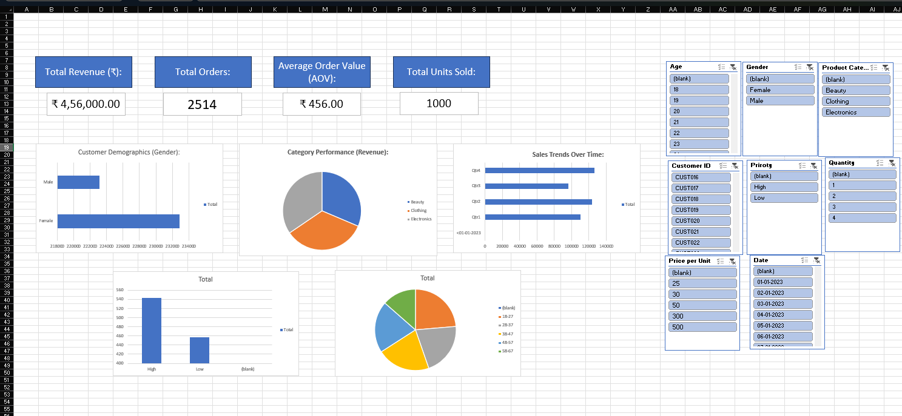

# Retail Sales Analysis Dashboard

## Project Overview
An interactive Excel dashboard built to analyse retail sales data, track financial KPIs, and visualise customer demographics and purchasing trends. 

## Key Performance Indicators (KPIs)
* **Total Revenue:** ₹4,56,000
* **Total Orders:** 2514
* **Average Order Value:** ₹456.00

## Dataset Used:
This project uses the Retail Sales Dataset from Kaggle. It contains 1,000 transaction records, including detailed fields for customer demographics (age, gender), product categories (electronics, clothing, beauty), purchase quantities, and pricing data, providing a solid foundation for end-to-end sales and customer analysis.

## Tools & Techniques Used
* Data Cleaning & Formatting
* XLOOKUP & Logical Functions
* Pivot Tables & Power Query
* Interactive Slicers & Data Visualisation

## Dashboard Preview

